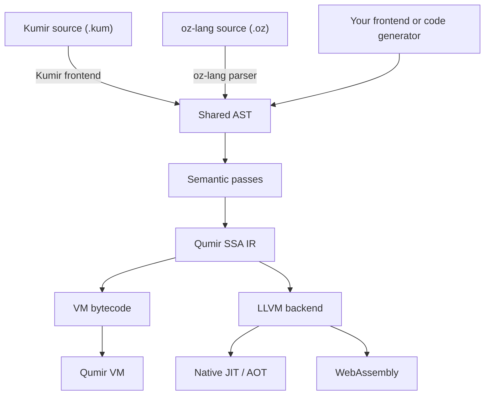

# Qumir

Qumir is a compiler and runtime for implementing embedded and standalone
programming languages. Its C++ library provides type checking, optimization,
code generation, and runtime support. Use it when an application needs to run
user-defined formulas or processing rules, or when a language implementation
needs a shared foundation for execution.

**oz-lang** is Qumir's typed core language: a textual representation of its
shared abstract syntax tree (AST), written as **S-expressions**. It can serve
as an intermediate language for your frontend or for generated computations.
You can generate oz-lang source or construct the same AST directly through
the C++ API. The compiler lowers the AST to its own SSA IR, then to bytecode
for Qumir's VM or to native code and WebAssembly through LLVM.
The documentation also calls oz-lang *core lang*.

**Kumir (КуМир)** is an existing educational language with Russian keywords.
**Qumir** is the compiler project, which includes a ready-to-use Kumir
frontend. It translates `.kum` programs into the shared AST and uses the same
compiler infrastructure as oz-lang. This frontend supports running Kumir
programs on a computer or in a browser.

[QumirDB](https://github.com/QumirLabs/qumirdb) demonstrates another use of
the library: its SQL planner generates computational kernels using oz-lang
and Qumir's compiler pipeline. The database supplies SQL semantics, query
planning, and scheduling; Qumir supplies the compilation layer.

- Try Kumir in the browser: [qumir.dev](https://qumir.dev)
- Kumir user documentation: [docs/ru/index.md](docs/ru/index.md)
- Kumir syntax: [docs/ru/syntax.md](docs/ru/syntax.md)
- Kumir examples: [docs/ru/examples.md](docs/ru/examples.md)
- oz-lang tutorial and reference: [docs/arch/core-lang.md](docs/arch/core-lang.md)
- Compiler architecture: [docs/arch/overview.md](docs/arch/overview.md)

## Contents

- [What is included](#what-is-included)
- [Quick start](#quick-start)
- [Command-line tools](#command-line-tools)
- [Compiler architecture](#compiler-architecture)
- [Core lang and embedding](#core-lang-and-embedding)
- [Repository layout](#repository-layout)
- [Documentation](#documentation)
- [License](#license)

## What is included

Qumir provides:

- oz-lang, a typed core language with a textual syntax and an AST API;
- a shared semantic pipeline and SSA IR for optimization and code generation;
- a bytecode compiler and VM for execution without LLVM JIT compilation;
- an LLVM backend for native JIT, ahead-of-time compilation, and WebAssembly;
- runtime support for strings, arrays, structs, and calls to host functions;
- a Kumir-compatible `.kum` frontend with Russian keywords;
- the Robot, Turtle, Painter, Drawer, Colors, Complex Numbers, and Keyboard
  modules, and the browser runtime used by the Kumir playground.

The Kumir frontend aims for practical compatibility with existing programs
and teaching materials. If a `.kum` program behaves differently from Kumir,
please [open an issue](https://github.com/QumirLabs/qumir/issues) with a
minimal example.

## Quick start

Requirements:

- CMake 3.30 or newer;
- a C++23 compiler;
- LLVM 20 or newer;
- Ninja or another CMake-supported build tool;
- `wasm-ld` when building WebAssembly programs.

Build the project:

```bash
cmake -S . -B build -DCMAKE_BUILD_TYPE=Release
cmake --build build -j
```

The resulting tools are `build/bin/qumiri` and `build/bin/qumirc`.

CMake compiles through ccache automatically when it is installed (turn it off
with `-DQUMIR_USE_CCACHE=OFF`; an explicit `CMAKE_*_COMPILER_LAUNCHER` wins). To
share one cache across git worktrees, put this in `ccache.conf` (`ccache -sv`
shows its path):

```ini
base_dir = /path/to/workspace-root
hash_dir = false
sloppiness = include_file_ctime,include_file_mtime,time_macros
max_size = 40G
```

With `hash_dir = false` the debug info of a cache hit names the worktree that
compiled the object first.

Run a program directly:

```bash
build/bin/qumiri -i test/regtest/cases/io/output.kum
```

Compile a native executable:

```bash
build/bin/qumirc hello.kum -o hello
./hello
```

A minimal `.kum` program looks like this:

```text
алг main
нач
    вывод "Привет, мир!", нс
кон
```

Run the test suite with:

```bash
cmake -S . -B build -DQUMIR_BUILD_TESTS=ON
cmake --build build -j
ctest --test-dir build --output-on-failure
```

## Command-line tools

### `qumiri`

`qumiri` parses and executes source from a file or standard input. It uses the IR interpreter by default; pass `--jit` to execute through LLVM.

```bash
build/bin/qumiri -i program.kum
build/bin/qumiri --jit -O2 -i program.kum
build/bin/qumiri --print-ast --print-ir -i program.kum
build/bin/qumiri --core -i test/regtest/cases/corelang/implicit_return.oz
```

Use `build/bin/qumiri --help` for the complete and current option list. See [docs/ru/interpreter.md](docs/ru/interpreter.md) for a guided reference.

### `qumirc`

`qumirc` compiles source to a native executable, object file, assembly, LLVM IR, the internal IR, an AST dump, or WebAssembly.

```bash
build/bin/qumirc program.kum -o program
build/bin/qumirc --llvm program.kum -o program.ll
build/bin/qumirc --wasm program.kum -o program.wasm
```

Use `build/bin/qumirc --help` for all output modes and optimization flags. See [docs/ru/compiler.md](docs/ru/compiler.md) for more examples.

## Compiler architecture

Kumir and oz-lang have separate parsers that build the same AST. A host
application can also construct that AST directly. The shared semantic passes
resolve names, check types and definite assignment, and make lifetime
operations explicit before lowering to Qumir's SSA IR.



The bytecode backend compiles IR to instructions for Qumir's own VM.
The LLVM backend generates native code for JIT or ahead-of-time execution,
and WebAssembly for browser execution. The CLI tools are wrappers around
the same library used by embedded applications.

To add a language frontend, generate oz-lang or construct the shared AST
and reuse the semantic passes and backends. To add an execution backend,
consume Qumir IR and implement instruction lowering and runtime integration
for the target. The existing frontends and semantic passes can be reused.

Host modules expose types and functions to the language. Native execution
uses registered function pointers; VM execution uses packed call thunks.
The [embedding section](#embedding-in-c) shows how these bindings are registered.

For the IR model, runtime ABI, and module system, start with
[the architecture overview](docs/arch/overview.md). Separate notes cover
[arrays](docs/arch/arrays.md), [strings](docs/arch/strings.md),
[structs](docs/arch/structs.md), and [coroutines](docs/arch/coroutine.md).

## Core lang and embedding

oz-lang, also called core lang, represents Qumir's shared AST as S-expressions.
An application can use it to express formulas, filters, or generated
computational kernels, then execute them with the VM or compile them through
LLVM. A language frontend can generate this representation while relying on
Qumir for the shared compilation stages.

It supports typed and overloaded functions, generic specialization, references, managed strings, arrays, structs, SIMD vectors, and coroutines. The [oz-lang guide](docs/arch/core-lang.md) teaches these features through complete programs and includes a syntax reference and current implementation limits.

Example:

```core
(block
  (fun <main> ()
    (block
      (output (call square (: 5 i64)) "\n")))

  (fun square ((var x i64)) -> i64
    (block
      (* x x))))
```

Run it through the interpreter or JIT:

```bash
build/bin/qumiri --core -i program.oz
build/bin/qumiri --core --jit -O2 -i program.oz
```

### Embedding in C++

The public library exposes two high-level runners:

- `NQumir::TIRRunner` parses, resolves, lowers, and executes through the IR interpreter;
- `NQumir::TLLVMRunner` runs the same pipeline through LLVM and can compile a core-lang kernel to a function pointer with `CompileKernel()` or `CompileKernelAst()`.

For core input, set `CoreInput = true` in `TIRRunnerOptions` or `TLLVMRunnerOptions`:

```cpp
#include <qumir/runner/runner_ir.h>

#include <iostream>
#include <sstream>

std::istringstream source(R"(
(block
  (fun <main> ()
    (block
      (output "hello from core lang\n"))))
)");

NQumir::TIRRunner runner(
    std::cout,
    std::cin,
    NQumir::TIRRunnerOptions {
        .CoreInput = true,
    });

auto result = runner.Run(source);
if (!result) {
    std::cerr << result.error().ToString();
    return 1;
}
```

To expose host functionality to the language, implement `NQumir::NRegistry::IModule` from `qumir/modules/module.h`. Register it with `TLLVMRunner::RegisterModule()` for the LLVM path, or with `TNameResolver::RegisterModule()` when assembling the lower-level IR pipeline:

- `Ptr` is the native function pointer used by LLVM;
- `Packed` is the interpreter thunk using `uint64_t` argument and result slots;
- `ArgTypes` and `ReturnType` define the signature visible to semantic analysis;
- `ExternalTypes`, `LiteralSuffixes`, and `Dependencies` extend the language surface when needed.

The built-in [Turtle module](qumir/modules/turtle/turtle.cpp) is a compact example. [System module](qumir/modules/system/system.cpp) shows strings, I/O, operators, and a broader set of function signatures.

For lower-level control, a host can parse core lang with `qumir/parser/core`, construct or transform `NAst::TExpr` trees directly, run `NTransform::Pipeline`, lower with `NIR::TAstLowerer`, and then choose the interpreter or LLVM backend. This is the same pipeline used by the runners and command-line tools.

For browser embedding, compile with `qumirc --wasm` and provide the imported host functions. The JavaScript runtime used by the playground is in [service/static/runtime](service/static/runtime); an HTTP compiler service is only needed when source must be compiled on demand.

## Repository layout

- `qumir/` contains the reusable compiler, runtime interfaces, modules, runners, IR, and LLVM backend.
- `bin/` contains `qumiri` and `qumirc`.
- `test/` contains unit and regression tests, including `.kum` and `.oz` programs.
- `examples/` contains complete Kumir programs grouped by topic and executor.
- `service/` contains the online playground service and browser runtime.
- `docs/` contains user documentation, architecture notes, and design issues.

## Documentation

On the website, a `kumir` code block inside `<qumir-example id="unique-id">` becomes an editable, runnable example. Set `io="false"` on the tag to hide the input/output panel for graphics examples; execution results and errors remain visible below the editor. The panel is visible by default, or with `io="true"`. Keep it visible when readers need text input, output, or file editing. Robot fields can be edited directly in the preview even with `io="false"`. Markdown code blocks and screenshots remain readable on GitHub.

- [User documentation](docs/ru/index.md)
- [Syntax reference](docs/ru/syntax.md)
- [Standard functions](docs/ru/standard-functions.md)
- [Examples](docs/ru/examples.md)
- [FAQ](docs/ru/faq.md)
- [Architecture overview](docs/arch/overview.md)
- [oz-lang tutorial and reference](docs/arch/core-lang.md)
- [Code style](docs/arch/codestyle.md)

## License

Qumir is distributed under the BSD 2-Clause License. See [LICENSE](LICENSE).
